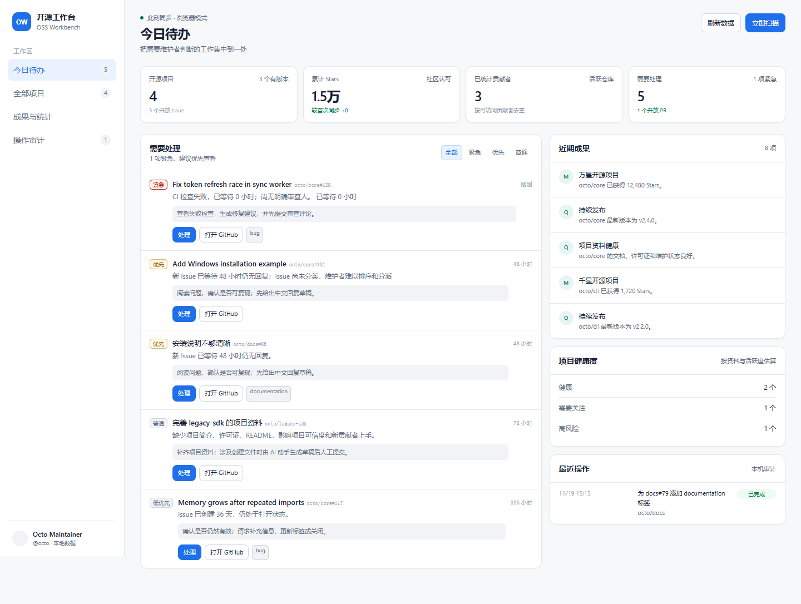
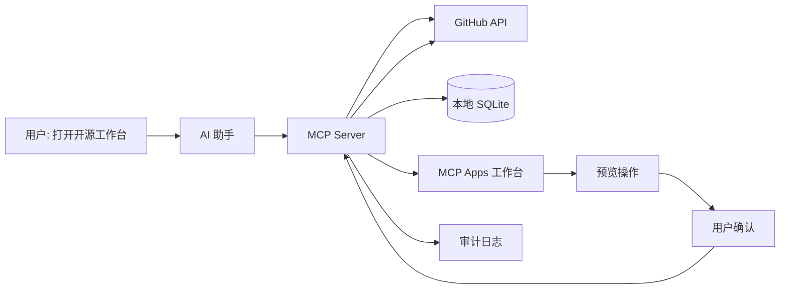

# OSS Workbench · 开源工作台

> 在 AI 助手里直接管理你的 GitHub 开源项目：打开工作台、扫描待办、点击处理、查看开源成果。

OSS Workbench 是一个 **本地优先、AI 助手原生** 的开源项目管理工作台。它不复制 GitHub，也不要求你更换代码托管平台。GitHub 仍然是仓库、Issue、PR 和 Release 的事实来源；OSS Workbench 负责中文界面、跨项目扫描、可执行待办、成果统计和操作审计。



## 为什么做这个项目

维护开源项目时，真正耗时的通常不是写代码，而是持续处理这些碎片工作：

- 新 Issue 没人回复，旧 Issue 越来越多。
- PR 等待审查、CI 失败或发生冲突。
- 项目缺少 README、许可证和简介。
- 想知道项目最近取得了什么成果，但 GitHub 原生页面不提供统一视角。
- 想在 DeepSeek Harness、WorkBuddy、Codex、OpenClaw 等不同 AI 助手中使用同一套管理能力。

OSS Workbench 把这些工作收敛成一条流程：

> 在对话中说“打开开源工作台” → 扫描需要处理的工作 → 点击处理 → 预览变更 → 确认执行 → 写入审计。

## 功能

### 对话内工作台

- 通过 MCP Apps 在支持的 AI 助手中渲染交互式工作台。
- 终端或未支持 UI 的宿主自动回退为文字摘要和浏览器工作台。
- 同一套前端既能在对话中运行，也能独立在 `http://127.0.0.1:3789/workbench` 打开。

### 待办扫描

扫描授权账号下可访问的开源项目，生成需要维护者判断的事项：

- CI 检查失败
- PR 等待审查、发生冲突
- 新 Issue 无回复、未分类
- 长期未更新的 Issue
- 缺少简介、许可证或 README
- 待处理事项按 P0–P3 排序，同一 Issue/PR 的多条原因会合并展示

### 点击处理

每个待办都提供可执行动作：

- 发表评论
- 添加标签
- 指派负责人
- 关闭 Issue 或 PR
- 提交 PR 审查评论
- 批准 PR
- 请求修改
- 稍后处理

所有写操作都采用两阶段流程：**准备预览 → 用户确认 → 执行**。MCP 工具层同时拆分 `task_prepare_action` 和 `task_commit_action`，防止 AI 直接修改 GitHub。

### 项目与成果统计

- 项目数、Stars、Forks、开放 Issue/PR、Release 下载量。
- 已统计贡献者（可访问活跃仓库去重）。
- Stars 变化趋势从首次同步快照开始记录。
- 项目健康度：综合资料完整度、许可证、最近活跃时间和待处理工作量。
- 成果里程碑：百星/千星/万星、持续发布、资料健康、多项目维护者等。

### 授权账号下的全部开源项目

默认同步当前 GitHub 用户拥有的：

- 公开仓库
- 非 Fork
- 非归档

可在配置中选择包含私有仓库、Fork、归档项目和组织项目，也可以排除指定仓库。

### 审计与安全

- 本地 SQLite 存储，无外部数据库依赖。
- 默认仅开放只读扫描。
- 执行操作必须产生预览并获得明确确认。
- 自动合并 PR、发布 Release、删除仓库和修改权限不在自动动作范围内。
- 每次准备、执行、失败和取消操作都会记录在本机审计日志中。

## 支持的 AI 助手

| 助手 | MCP 工具 | 对话内工作台 | 说明 |
|---|---|---|---|
| WorkBuddy | 支持 | 支持 | 桌面端可通过 MCP Apps 在对话或右侧产物区展示 |
| DeepSeek Harness | 支持 | 取决于宿主 | 使用 `dsh-mcp-client` 接入；交互 UI 需要兼容 MCP Apps 的宿主插件 |
| Codex | 支持 | 取决于宿主 | CLI/IDE/桌面端通过 MCP 接入；终端可能只显示文字，浏览器工作台始终可用 |
| OpenClaw | 支持 | 支持，需开启 | 开启 MCP Apps host 后可渲染；否则使用文字摘要 |
| 其他 MCP 客户端 | 支持 | 不一定 | 通过 stdio 或 Streamable HTTP 接入 |

> MCP Apps 的宿主支持会随版本变化。项目不假设所有助手都能渲染交互界面，因此核心工具始终保留文字回退和浏览器回退。

## 快速开始

### 环境要求

- Node.js **22.5+**（使用内置 `node:sqlite`）
- 一个 GitHub Token
- 支持 MCP 的 AI 助手，或仅使用浏览器版工作台

### 1. 获取项目

```bash
git clone https://github.com/zhing99-hash/oss-workbench.git
cd oss-workbench
npm install
npm run build
npm link
```

`npm link` 会把 `oss-workbench` 命令链接到全局。也可以直接使用：

```bash
node dist/index.js <command>
```

### 2. 配置 GitHub Token

推荐使用 fine-grained personal access token：

- 仓库访问范围：目标账号的全部公开仓库；需要私有项目时再选择私有仓库。
- Repository permissions：
  - Metadata：Read
  - Contents：Read
  - Issues：Read and write
  - Pull requests：Read and write
  - Actions：Read
  - Releases：Read

通过环境变量使用，避免把 Token 写进配置文件：

```bash
export GITHUB_TOKEN=github_pat_xxx
```

Windows PowerShell：

```powershell
$env:GITHUB_TOKEN = "github_pat_xxx"
```

也可以保存到本机配置：

```bash
oss-workbench auth --token github_pat_xxx
```

配置保存在 `~/.oss-workbench/config.json`。环境变量 `GITHUB_TOKEN` / `GH_TOKEN` 的优先级高于本地配置。

### 3. 连接并扫描

```bash
oss-workbench doctor
oss-workbench sync
oss-workbench scan
```

### 4. 打开工作台

```bash
oss-workbench workbench
```

默认地址：`http://127.0.0.1:3789/workbench`

## 在各 AI 助手中安装和使用

### WorkBuddy

自动安装 MCP 配置和 Skill：

```bash
oss-workbench install workbuddy
```

安装器会：

1. 将 `oss-workbench` 合并到 `~/.workbuddy/mcp.json`。
2. 将 Skill 安装到 `~/.workbuddy/skills/oss-workbench/`。

重启 WorkBuddy 后，在对话中输入：

> 打开开源工作台

也可以手动添加 MCP：

```json
{
  "mcpServers": {
    "oss-workbench": {
      "type": "stdio",
      "command": "npx",
      "args": ["-y", "github:zhing99-hash/oss-workbench", "serve"]
    }
  }
}
```

手动配置后，将 [`adapters/workbuddy/SKILL.md`](adapters/workbuddy/SKILL.md) 放入 WorkBuddy 的技能目录，或通过 WorkBuddy 的“上传技能”入口导入。

**可用指令：**

- “打开开源工作台”
- “扫描我的开源项目，只告诉我紧急事项”
- “查看项目成果和 Stars 变化”
- “把 octo/core#128 的审查意见生成预览”

### DeepSeek Harness

OSS Workbench 使用标准 MCP stdio 工具。

#### 方式一：作为 DSH 插件安装

仓库声明了 `dsh.bundle`，可以整包装进 profile，安装后 `mcp__oss-workbench__*` 工具自动注册：

```bash
dsh plugin --profile web add github:zhing99-hash/oss-workbench
```

pnpm 默认不执行依赖的构建脚本，首次安装会提示需要允许本插件构建（`allowBuilds`），按提示在 profile 的 `pnpm-workspace.yaml` 里允许后重跑同一条命令即可。

DSH 不会把 `GITHUB_TOKEN` / `GH_TOKEN` 透传给子进程，插件的 `cordis.patch.yml` 已显式转发这两个变量；也可以先运行 `oss-workbench auth --token <token>` 把 Token 存到本机，插件会自己读取。

#### 方式二：手动写入 MCP 客户端配置

先安装 DeepSeek Harness 的 MCP 客户端：

```bash
dsh plugin --profile web add @deepseek-ai/dsh-mcp-client
```

生成适配片段：

```bash
oss-workbench install dsh
```

片段位于：

```text
~/.oss-workbench/adapters/dsh/oss-workbench.patch.yml
```

将内容合并到目标 profile 的 `cordis.patch.yml`：

```yaml
- id: oss-workbench
  name: '@deepseek-ai/dsh-mcp-client'
  config:
    serverName: oss-workbench
    transport: stdio
    command: npx
    args: ["-y", "github:zhing99-hash/oss-workbench", "serve"]
```

重启 profile：

```bash
dsh --profile web
```

DeepSeek Harness 的 MCP 客户端可以把工具注册为 `mcp__oss-workbench__*`。如果当前宿主未安装 MCP Apps 兼容层，工作台会以文字摘要呈现；此时运行 `oss-workbench workbench` 使用完整浏览器工作台。

> 第三方 MCP Apps host 插件可以增强对话内 UI，但本项目不捆绑、不默认安装第三方插件。安装前请自行审查来源、权限和更新方式。

### Codex

命令行添加：

```bash
codex mcp add oss-workbench -- npx -y github:zhing99-hash/oss-workbench serve
```

或写入 `~/.codex/config.toml`：

```toml
[mcp_servers.oss-workbench]
command = "npx"
args = ["-y", "github:zhing99-hash/oss-workbench", "serve"]
```

重新启动 Codex 后运行 `/mcp` 检查连接。然后可以直接说：

> 打开开源工作台，汇总今天的待办。

Codex 的终端界面可能只显示文字结果；运行 `oss-workbench workbench` 打开完整工作台。Codex IDE 或支持 MCP Apps 的宿主可以直接显示交互界面。

### OpenClaw

添加 MCP 服务：

```bash
openclaw mcp add oss-workbench \
  --command npx \
  --arg -y \
  --arg github:zhing99-hash/oss-workbench \
  --arg serve
```

启用 MCP Apps 交互界面：

```bash
openclaw config set mcp.apps.enabled true --strict-json
openclaw gateway restart
openclaw mcp doctor oss-workbench --probe
```

安装 Skill：

```bash
oss-workbench install openclaw
```

Skill 会复制到 `~/.openclaw/skills/oss-workbench/`。如果没有安装 OpenClaw CLI，安装器会保留 Skill 并提示手动添加 MCP。

在 Control UI 中输入：

> 打开开源工作台。

### 其他 MCP 客户端

通用 stdio 配置：

```json
{
  "mcpServers": {
    "oss-workbench": {
      "command": "npx",
      "args": ["-y", "github:zhing99-hash/oss-workbench", "serve"]
    }
  }
}
```

HTTP 模式：

```bash
oss-workbench serve --http --port 3789
```

- 工作台：`http://127.0.0.1:3789/workbench`
- MCP Streamable HTTP：`http://127.0.0.1:3789/mcp`

服务只绑定 `127.0.0.1`，不对外网开放。

## 工作台如何工作



工作台中的写操作不直接由前端访问 GitHub。前端只调用 MCP 工具或本地 API，后端统一执行权限策略、预览校验和审计记录。

## 常用命令

```bash
oss-workbench serve                 # stdio MCP 服务
oss-workbench serve --http          # MCP + 本地工作台
oss-workbench workbench             # 浏览器工作台
oss-workbench sync                  # 同步 GitHub 数据
oss-workbench scan                  # 查看当前待办
oss-workbench doctor                # 诊断授权和安装
oss-workbench auth --token <token>  # 保存 Token
oss-workbench install workbuddy     # 安装到指定助手
oss-workbench install all           # 尝试安装到全部支持的助手
oss-workbench status                # 查看平台安装状态
oss-workbench config                # 查看脱敏后的配置
```

## 配置

配置文件：`~/.oss-workbench/config.json`

```json
{
  "version": 1,
  "github": {
    "apiBaseUrl": "https://api.github.com"
  },
  "account": {
    "includePrivate": false,
    "includeForks": false,
    "includeArchived": false,
    "includeOrganizations": false,
    "exclude": []
  },
  "workbench": {
    "port": 3789,
    "syncMinutes": 15
  }
}
```

环境变量：

- `GITHUB_TOKEN` / `GH_TOKEN`：GitHub Token。
- `OSS_WORKBENCH_HOME`：数据目录，默认 `~/.oss-workbench`。

## 统计口径与限制

这是一个可运行的 MVP，不把未经验证的数据包装成事实：

- Stars、Forks、开放 Issue/PR 是同步时的 GitHub 当前值。
- Stars 趋势从本机首次快照开始记录，无法反推安装前的完整历史。
- 贡献者数量来自已同步活跃项目的可访问贡献者去重，不等同于 GitHub 全站统计。
- GitHub 流量（views/clones）受 API 时间窗口限制，本项目不伪造长期流量。
- 默认对最多 24 个最近活跃项目补充 Release、README 和贡献者详情；其余项目仍同步基础统计和 Issue/PR。
- GitHub 搜索 API 单次最多返回 1000 条结果，大规模项目需要后续分页增强。
- 当前只支持 personal access token，尚未实现 GitHub App OAuth。
- 当前不包含自动改代码、自动合并、自动发布和批量高风险操作。

## 安全

- Token 仅用于本机进程访问 GitHub API。
- 不要把 Token 写进 Skill、README、Issue 或聊天记录。
- 操作预览 10 分钟内有效。
- 关闭 Issue、批准 PR、请求修改等动作需要用户确认。
- 合并 PR、发布 Release、删除仓库、修改权限不属于自动动作。
- 本地 HTTP 服务只监听回环地址，并校验浏览器 Origin。
- 发现安全问题请阅读 [SECURITY.md](SECURITY.md)。

## 开发

```bash
npm install
npm run build
npm test
npm run typecheck
```

项目结构：

```text
src/
  github.ts       GitHub REST 客户端
  sync.ts         项目、Issue、PR、Release 同步
  scan.ts         待办规则、健康度、成果计算
  actions.ts      两阶段操作与审计
  mcp.ts          MCP 工具、资源、MCP Apps 元数据
  http.ts         本地工作台 API 与 Streamable HTTP
  install.ts      WorkBuddy / Codex / OpenClaw / DSH 安装适配
ui/               对话内与浏览器共用工作台
adapters/         各 AI 助手 Skill 与配置说明
test/             核心规则与 MCP 契约测试
```

开发模式：

```bash
npm run build
OSS_WORKBENCH_HOME=/tmp/oss-workbench-demo GITHUB_TOKEN=demo-token node scripts/seed-demo.mjs
OSS_WORKBENCH_HOME=/tmp/oss-workbench-demo GITHUB_TOKEN=demo-token node dist/index.js workbench --port 3899
```

> 演示数据只能写入路径中包含 `demo` 的独立目录，避免污染真实数据。

## Roadmap

- [x] GitHub 账号授权与全部公开项目同步
- [x] 待办扫描、优先级和合并去重
- [x] 工作台、成果统计与项目健康度
- [x] 两阶段处理动作与审计
- [x] WorkBuddy / Codex / DeepSeek Harness / OpenClaw 安装说明
- [ ] GitHub App OAuth 与团队模式
- [ ] 自动生成中文周报、Release Note 和回复草稿
- [ ] AI 开发任务：从 Issue 到隔离分支和 PR
- [ ] 组织级项目组合与权限策略
- [ ] 批量安全操作与定时扫描

## 贡献

欢迎提交 Issue 和 PR。开始前请阅读 [CONTRIBUTING.md](CONTRIBUTING.md)。新增 AI 助手适配时，请优先复用 MCP 工具和统一工作台，不要复制业务逻辑。

## License

[MIT](LICENSE)
